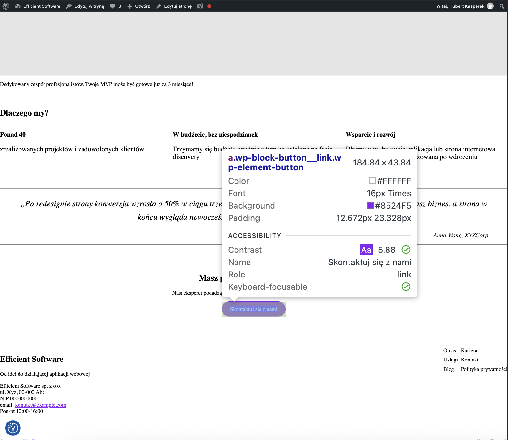
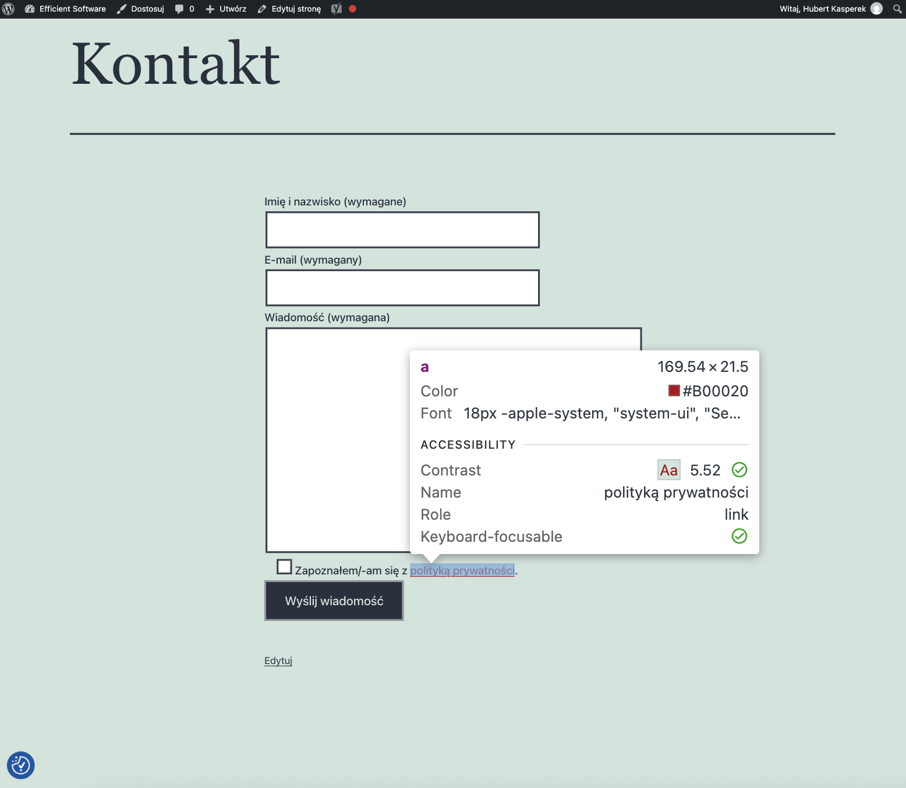
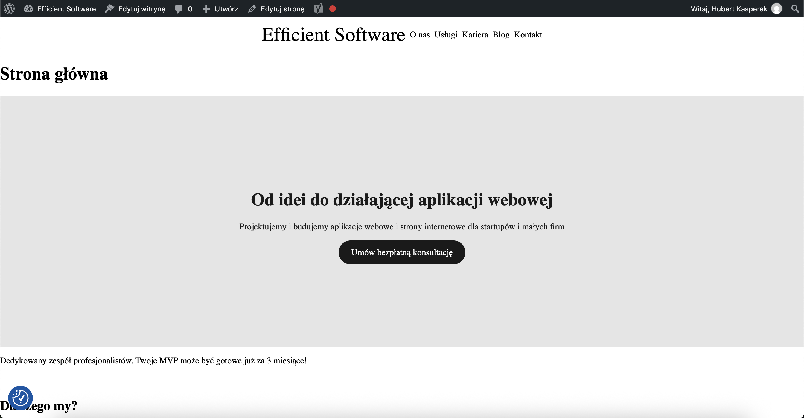
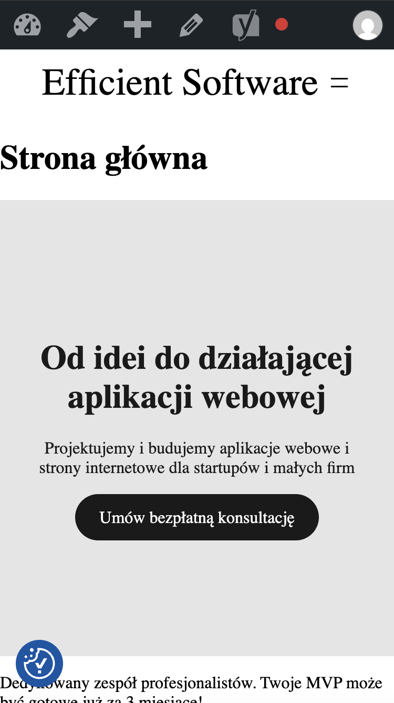
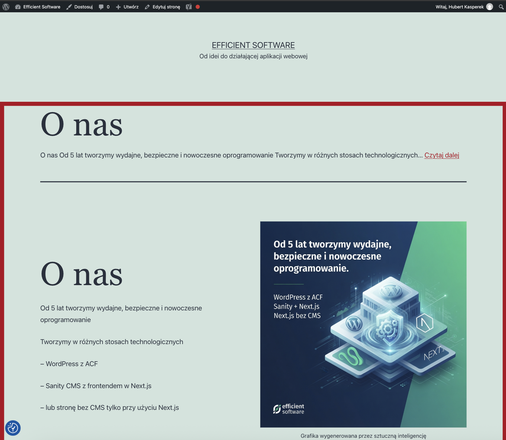
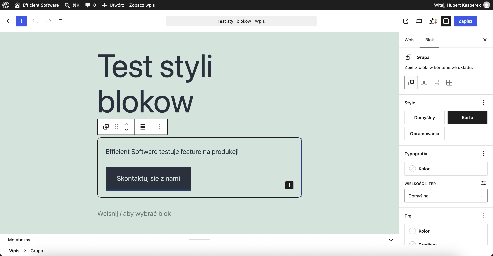

# MP2

Autor: Hubert Kasperek

strona z MP1: [https://github.com/HKasperekCDV/cms-lab](https://github.com/HKasperekCDV/cms-lab)

## Typ motywu i dlaczego
Wykonałem obie ścieżki z L4 i L5
- Motyw blokowy "efficientsoftware" - strona z MP1 była budowana na blokach i motywie blokowym, motyw blokowy pozwala na edycje całej witryny w edytorze i przy pomocy wtyczki "Create Block Theme" zapisać zmiany do plików
- Motyw potomny, "mf-child" - bazowany na motywie Twenty Twenty-One i nadpisuje wybrane elementy - kolor linków, krój nagłówków, szablon podstrony "O nas" (z danymi firmy), własna długość zajawek, notka pod wpisami i dwa style bloków "Z cieniem" dla przycisku i "Karta" dla grupy. Ponieważ zmiany są w osobnym motywie, aktualizacja rodzica nic nie skasuje w tym motywie potomnym.

## Struktura plików

```
wp-content/themes
   efficientsoftware/
      style.css
      theme.json
      templates/
         index.html
         single.html
         page.html
         archive.html
         404.html
      parts/
         header.html
         footer.html
      patterns/
         hero-z-cta.php
         cta-kontakt.php
      mf-child/
         style.css
         functions.php
         page-o-nas.php
```

## Hierarchia szablonów - motyw blokowy efficientsoftware
Pojedynczy wpis - single.html
Strona (np. Kariera) - page.html
Lista wpisow (podstrona Blog) - index.html
Archiwum kategorii - archive.html
Nieistniejący adres - 404.html

## Co zmieniłem względem motywu bazowego
- efficientsoftware - nagłówek i stopka przeniesiona z MP1 (części szablonu Twenty Twenty-Five, zmodyfikowane w MP1 - menu zgodne z mapą strony a stopka z danymi firmy), wykonując L4 zmieniłem wyrównanie nagłówka i theme.json ze startera L3 z paletą (tło: #ffffff, tekst: #1a1a1a i kolor marki jaki sam wybrałem: #8524f5)
- mf-child - kolor linków #b000020, szeryfowy krój nagłówków, szablon page-o-nas.php z danymi firmy, hooki i style bloków - bez zmian w plikach motywu Twenty Twenty-One

### Użyte hooki (mf-child)
wp_enqueue_scripts wykonuje akcję ładowania style.css potomka po stylu rodzica
after_setup_theme wykonuje akcje ładowania tłumacczenia
excerpt_length filtruje - skraca zajawki do 16 słów
the_content - filtr - dodaje notkę "Masz pytania? Napisz do nas." pod pojedynczym wpisem
init - akcja - rejestruje style bloków "Z cieniem" dla przycisku i "Karta" dla grupy

## Dostępność
- kontrast koloru marki "#8524f5" z białym (np. tekst na buttonie "Skontaktuj się z nami") to 5,88:1 (min. 4,5:1 w WCAG)


  
- kontrast linków "#b000020" na tle Twenty Twenty-One to 5,52:1 (min. 4,5:1 w WCAG)



## Licencje fontów i grafik
- Fonty: motywy nie dołączają własnych plików fontów - używają fonty systemowe
- Grafiki: MP2 nie dodaje nowych grafik - treść stron pochodzi z [MP1](https://github.com/HKasperekCDV/cms-lab), gdzie opisałem ich źródła i licencje

## Zrzuty ekranu

### Strona główna - efficientsoftware


### Widok mobilny strony głównej - efficientsoftware


### Strona "O nas" - page-o-nas.php - mf-child


### Styl bloku "Karta" w edytorze - mf-child


## Użycie AI
Claude - poprawka wyświetlania zajawki (`wp_kses_post()`) - oznaczone odpowiednio w commit message 
